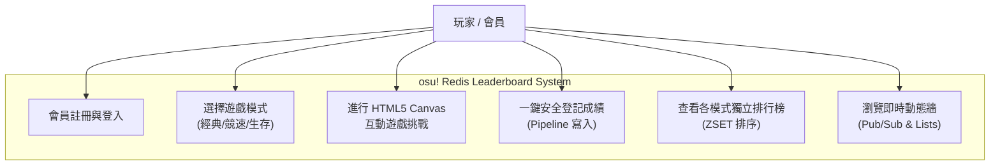
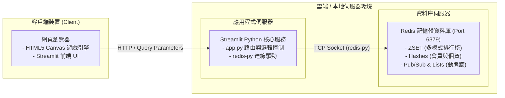

# 🚨圓圈點擊多模式挑戰賽 Redis 遊戲排行榜系統 (Circle Click Redis Leaderboard)

基於 **Python (Streamlit)** 與 **Redis 記憶體資料庫** 開發的高效能多模式線上遊戲排行榜系統。本專案將網頁節奏遊戲（osu! 風格 2D 圓圈極速點擊挑戰）與 NoSQL 資料庫的高階特性完美結合，提供極佳的即時互動體驗與後端效能。

---

## 🌟 核心特色與 Redis 技術亮點

本專案深入應用了 Redis 的多項進階功能，徹底發揮記憶體資料庫的高效能優勢：
1. **有序集合 (`Sorted Sets - ZSET`)**：實現各遊戲模式（經典、競速、生存）的獨立排行榜，支援毫秒級即時積分排序與個人最高分防護 (`gt=True`)。
2. **管線化 (`Pipelines`)**：將多項資料寫入指令（ZADD、PUBLISH、LPUSH、HSET）打包為單一網路請求發送，大幅減少來回延遲（RTT）。
3. **雜湊 (`Hashes`)**：用於安全管理會員帳號密碼認證，以及結構化儲存玩家個人檔案、頭銜與最佳成績。
4. **發布／訂閱與列表 (`Pub/Sub` & `Lists`)**：實現即時動態牆公告與歷史佇列快取（透過 `LTRIM` 固定保留最近動態）。

---

## 🎮 遊戲模式介紹

* **🎮 經典模式 (Classic)**：15 秒內盡可能點擊隨機生成的圓圈，挑戰最高總得分。
* **⚡ 競速模式 (Speedrun)**：計時點完固定 20 個圓圈所花費的總時間（精確至小數點後第二位），以最短時間登頂。
* **🛡️ 生存模式 (Survival)**：每個圓圈限時 **0.7 秒**，隨進度條縮減，逾時未點擊即遊戲結束，考驗極限反應力。

---

## 🛠️ 系統架構與技術棧

* **前端介面 (Frontend)**：Streamlit UI + 內嵌 HTML5 Canvas (60 FPS 高效能 2D 遊戲引擎)
* **後端邏輯 (Backend)**：Python (`streamlit`, `redis-py`)
* **資料庫 (Database)**：Redis 7.x (透過 Docker 容器化部署)

---

## 📊 系統設計與 UML 架構

### 1. 用例圖 (Use Case Diagram)

### 2. 部署圖 (Deployment Diagram)

